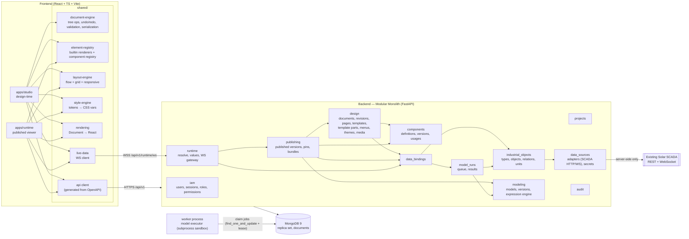
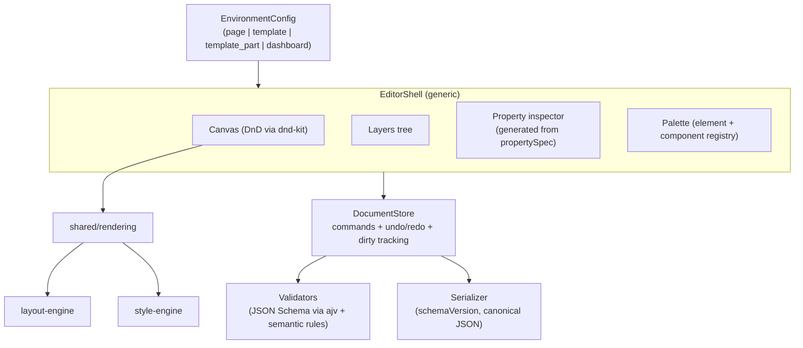

# ۰۲ — معماری سطح بالا

## ۱. سبک معماری
**Modular Monolith** (ADR-0001): یک backend واحد FastAPI که به ماژول‌های دامنه‌ای با مرز صریح تقسیم شده، یک پایگاه دادهٔ MongoDB (replica set؛ ADR-0015)، یک **پروسهٔ worker** جدا (همان codebase) برای اجرای مدل‌ها، و دو اپ فرانت که از یک کتابخانهٔ مشترک ساخته می‌شوند:

- **Studio (design-time)**: ویرایشگرها (Theme/Component/Object/Page/Dashboard Builder، Modeling).
- **Runtime viewer**: فقط خواندنی؛ bundle منتشرشده را رندر می‌کند. هیچ کد editor (dnd-kit، inspector، undo) در bundle runtime نیست.

هر دو اپ از `shared/rendering` (renderer مشترک document tree) استفاده می‌کنند؛ پس «آنچه در preview می‌بینید همان است که در runtime رندر می‌شود».

## ۲. نمودار ماژول‌ها



## ۳. سه حوزهٔ جدا: design-time / runtime / modeling

| جنبه | Design-time (Studio) | Runtime | Modeling engine |
|---|---|---|---|
| دادهٔ ورودی | head revision پیش‌نویس | **فقط** PublishedVersion زنده | ModelVersion منتشرشده + ورودی‌های resolved |
| تغییرپذیری | mutable با If-Match | immutable؛ cache با ETag = id نسخه | نتایج append-only |
| Component | آخرین نسخه‌های قابل استفاده (draft مجاز در preview) | نسخهٔ pin‌شده در bundle | — |
| Binding | spec زندهٔ DataBinding | snapshot binding در bundle | `defaultSource` ورودی‌ها |
| اجرا | مرورگر (editor) + API | مرورگر (viewer سبک) + RT gateway | پروسهٔ worker، subprocess با timeout |
| دسترسی | `page.edit`, ... | `runtime.view` | `model.run` |

**قاعده‌های مرزی:**
1. ماژول `runtime` هرگز جدول‌های draft (`document_revisions` head، `data_bindings` زنده) را نمی‌خواند؛ فقط `published_versions.bundle` و مقادیر زنده/نتایج مدل.
2. editor هرگز مستقیماً به SCADA وصل نمی‌شود؛ همهٔ داده از `data_sources` adapter سمت سرور عبور می‌کند (اپ موجود برعکس است و دلیل اصلی جدا نگه داشتن آن همین است).
3. موتور مدل‌سازی از UI مستقل است: یک کتابخانهٔ خالص Python (`modeling/engine`: parser → AST → DAG → evaluator) که هم API (validate) و هم worker (execute) از آن استفاده می‌کنند. هیچ وابستگی به FastAPI/ORM ندارد تا قابل تست واحد و قابل جایگزینی باشد.

## ۴. Design core مشترک (فرانت)



- **EnvironmentConfig** تعیین می‌کند: انواع node مجاز، کامپوننت‌های مجاز (`layoutConstraints.allowedDocumentTypes`)، layout engine (flow برای page/header، grid برای dashboard)، وجود `slot` (فقط template)، breakpointها و toolbar.
- **Command pattern** برای همهٔ تغییرات (`insertNode`, `moveNode`, `updateProps`, `setBinding`, ...) → undo/redo و همچنین patch-log برای audit سمت کلاینت.
- **Validation دو لایه**: همان JSON Schemaهای `contracts/schemas` در مرورگر (ajv) و در سرور (jsonschema/Pydantic) + قواعد معنایی (یکتایی id، slot، وجود definition/version، اعتبار props با propertySpec). سرور مرجع نهایی است.
- **Element registry**: map از `rendererId` به React component داخلی؛ ComponentDefinition فقط به یکی از آن‌ها اشاره می‌کند (ADR-0007).

## ۵. مرزها و APIهای داخلی ماژول‌ها (backend)

قواعد کلی:
- هر ماژول: `api/` (router)، `service.py` (public interface)، `repository.py`، `models.py` (dataclass + repository، ADR-0015)، `schemas.py` (Pydantic). **ماژول‌ها فقط از `service` یکدیگر استفاده می‌کنند**، نه از جدول‌ها/ORMهای هم. این قاعده با `import-linter` در CI اعمال می‌شود.
- ارتباط هم‌زمان = فراخوانی تابع service در همان تراکنش. رویدادهای داخلی (in-process event bus ساده، مثل `ComponentVersionPublished`) برای به‌روزرسانی indexها؛ بدون broker.

| ماژول | Public service (نمونه) | وابسته به |
|---|---|---|
| iam | `authenticate()`, `require(permission, project_id)`, `current_user()` | — |
| projects | `get_project()`, `get_active_theme_id()` | iam |
| design | `save_document(doc_id, content, if_match)`, `get_revision()`, `restore_revision()`, `resolve_template_parts(page)` | components, data_bindings, iam |
| components | `get_version(def_id, ver)`, `validate_instance_props()`, `assert_publishable(versions)` | iam |
| industrial_objects | `get_object()`, `get_variable_spec()`, `resolve_variable_source()` | data_sources |
| data_sources | `read_latest(source_id, signals)`, `subscribe(...)`, `search_signals()` | — (secrets داخل خود ماژول) |
| data_bindings | `get_bindings(ids)`, `resolve_values(bindings)` | industrial_objects, model_runs |
| modeling | `validate_spec(spec)`, `compile(spec)` → AST/DAG | (engine خالص) |
| model_runs | `enqueue(model_version, args)`, `latest_result(model_id, output)` | modeling, industrial_objects |
| publishing | `publish(document_id, revision_no)` → bundle + pins، `activate(version)` | design, components, data_bindings, projects |
| runtime | `resolve(project_slug, path)`, WS gateway | publishing, data_bindings |
| audit | `record(action, entity, summary)` | — |

## ۶. جریان‌های کلیدی

### ۶.۱ ذخیرهٔ سند (optimistic concurrency)
```mermaid
sequenceDiagram
  participant E as Studio
  participant A as API (design)
  participant DB as MongoDB
  E->>A: PUT /pages/{id}/document  If-Match: "rev-7"
  A->>A: schema + semantic validation
  A->>DB: startTransaction; find documents{_id} → head_revision_no (If-Match check)
  alt head != 7
    A-->>E: 412 problem+json (currentEtag "rev-9")
  else
    A->>DB: INSERT document_revisions(rev 8); UPDATE documents SET head_revision_no=8
    A->>DB: rebuild component_usages; INSERT audit_logs; COMMIT
    A-->>E: 200 ETag "rev-8"
  end
```

### ۶.۲ انتشار
`publish(revision)` در یک تراکنش: بارگذاری revision → جمع‌آوری `component` nodeها → اطمینان از `published` بودن هر (definitionId, version) → resolve تم فعال (آخرین theme_version منتشرشده) و template partهای منطبق → snapshot specهای binding → ساخت `bundle` (JSON canonical) + `bundle_hash` → درج `published_versions` و `published_version_pins` → جابه‌جایی `documents.live_published_version_id`. پس از commit، `runtime` cache را با ETag جدید invalidate می‌کند.

### ۶.۳ اجرای مدل
`POST /models/{id}/runs` → درج ردیف `model_runs(status=queued)` → worker با `find_one_and_update` اتمیک + lease claim می‌کند (ADR-0015 §8) → resolve ورودی‌ها (از adapter یا آرگومان) و ذخیرهٔ snapshot آن‌ها → ارزیابی در subprocess با timeout سخت و سقف حافظه/گام → درج `model_results` → `succeeded|failed|timed_out` → `NOTIFY model_run_updated` → gateway وضعیت را به WS مشترکین می‌فرستد.

### ۶.۴ داده زنده در runtime
Runtime bundle را می‌گیرد → به `/runtime/ws` وصل می‌شود و topicهای bundle (`binding:<id>`) را subscribe می‌کند → gateway برای هر binding نوع `object_variable` سیگنال SCADA را از adapter مشترک (یک اتصال WS سرور به SCADA برای همهٔ کاربران) دریافت و پس از تبدیل واحد ارسال می‌کند. اگر مقدار نباشد: `quality=no_data` و کامپوننت حالت «بدون داده» نشان می‌دهد؛ هرگز مقدار ساختگی.

## ۷. ملاحظات امنیتی معماری
- **XSS**: هیچ HTML خامی در سند نیست (`localizedText` متن ساده؛ React escape می‌کند)؛ style فقط از whitelist ویژگی/مقدار (بدون `url()`/`expression`) و به CSS custom properties تبدیل می‌شود؛ SVGها sanitize می‌شوند؛ CSP سخت (`script-src 'self'`، بدون `unsafe-inline`/`unsafe-eval`).
- **NoSQL injection**: filterها فقط در کد سرویس ساخته می‌شوند و ورودی کاربر فقط به‌عنوان مقدار (نه کلید/اپراتور) وارد می‌شود؛ جست‌وجوی متنی با `re.escape`؛ فیلتر/sort از whitelist؛ نقش `ipApp` بدون DDL.
- **SSRF**: `baseUrl` منابع داده فقط از allow-list تنظیم‌شده در env سرور.
- **Authz**: dependency `require(permission, project_id)` در هر route + فیلتر `project_id` در هر query (تست خودکار «هر route یک permission دارد» مشابه `test_openapi.py`).
- **Secrets**: credentialهای Data Source با envelope encryption (کلید از env/secret mount) در جدول جدا؛ هرگز در API برگردانده نمی‌شوند.

## ۸. استقرار
Docker Compose (on-prem): `mongo` (replica set)، `api` (uvicorn)، `worker` (همان image، فرمان دیگر)، `web` (nginx سرو کردن build ایستای studio و runtime + reverse proxy `/api`). یک migration job (`python -m app.cli migrate` با هویت admin) قبل از api؛ api با کاربر محدود `ip_app`. بدون Redis در v1.
