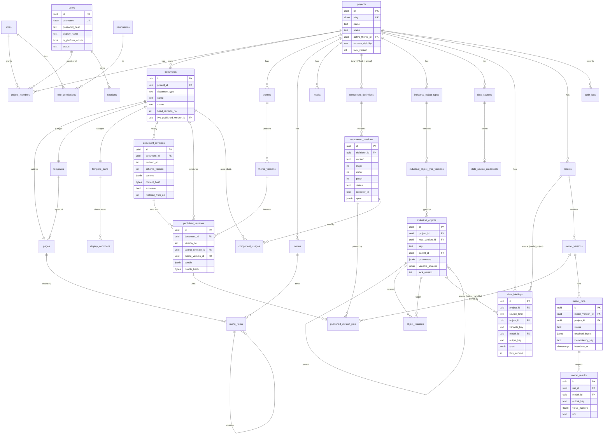

# ۰۳ — مدل دادهٔ مفهومی و ERD اولیه

> **2026-11-01 — datastore: MongoDB ([ADR-0015](../adr/0015-mongodb-single-datastore.md)).** موجودیت‌ها، فیلدها، قیود یکتایی و lifecycleهای زیر همچنان مدل **منطقی** معتبرند؛ نگاشت فیزیکی به MongoDB در §۰ آمده است. هر جا در ادامه «جدول/ستون/FK/JSONB/trigger» آمده، معادل آن در §۰ و ADR-0015 ملاک است. تعریف دقیق collectionها، `$jsonSchema` validatorها و ایندکس‌ها: `backend/app/migrations/m0001_initial.py`.

## ۰. نگاشت فیزیکی (MongoDB، پیاده‌شده در VS-1)
| مفهوم منطقی | فیزیکی |
|---|---|
| جدول | collection با همان نام (`users`, `sessions`, `projects`, `project_members`, `roles`, `permissions`, `component_definitions`, `component_versions`, `industrial_object_types`, `industrial_object_type_versions`, `industrial_objects`, `data_sources`, `data_bindings`, `documents`, `pages`, `document_revisions`, `published_versions`, `audit_logs`, `schema_migrations`) |
| PK `id uuid` | `_id` = رشتهٔ canonical UUIDv7 (تولید در اپ؛ شناسه‌های API بدون تغییر)؛ `roles`/`permissions` با کلید متنی |
| FK | فیلد `*_id` رشته‌ای؛ وجود/هم‌پروژه بودن در Service؛ **FK سمت سرور ندارد** — هیچ مسیر حذف برای موجودیت‌های ارجاع‌شده نیست |
| `role_permissions` | embed: `roles.permissions: [key]` |
| `object_relations` | embed: `industrial_objects.relations: [{relation_key, target_object_id}]` |
| `component_usages` | embed: `documents.component_usages: [{node_id, component_version_id, revision_no}]`، هم‌زمان با head بازنویسی می‌شود |
| `published_version_pins` | embed: `published_versions.pin_component_version_ids` |
| `pages.document_id` (PK/FK) | `pages._id` = `documents._id` |
| `pages.archived_at IS NULL` در UNIQUE جزئی | فیلد بولی `archived` + partial unique index `{archived: false}` روی `(project_id, path)` و `(project_id, slug)` |
| UNIQUE جزئی کتابخانهٔ سراسری کامپوننت | یک unique index `(project_id, key)`؛ `project_id: null` = سراسری و در ایندکس شرکت می‌کند |
| CHECK / NOT NULL / نوع | `$jsonSchema` validator (strict، error) |
| trigger تغییرناپذیری | `AppendOnlyRepo` (بدون update/delete) + نقش سرور `ipApp`: find+insert روی `document_revisions`, `published_versions`, `audit_logs`, `component_versions`؛ find-only روی کاتالوگ |
| `SELECT … FOR UPDATE` | تراکنش snapshot per-request + update شرطی روی `head_revision_no`/`lock_version` (412) |
| `audit_logs.id bigint identity` | UUIDv7 (ترتیب زمانی) |
| `timestamptz` | BSON date (UTC، دقت میلی‌ثانیه) |
| `sessions` | + TTL index روی `expires_at` (حذف ۷ روز پس از انقضا) |
| Alembic | `app/migrations` + `schema_migrations` (`python -m app.cli migrate [--check]`) |

## ۱. اصول
1. **فیلد سطح بالا برای هر چیزی که روی آن query، constraint یا authz داریم** (مالکیت، پروژه، وضعیت، شمارهٔ نسخه، slug/path، ارجاع‌ها). **زیرسند JSON برای محتوای طراحی** (document tree، spec کامپوننت/مدل/نوع شیء، tokens). ADR-0015 (جایگزین ADR-0004).
2. **شناسه‌ها** UUIDv7 تولیدشده در اپلیکیشن، ذخیره به‌صورت رشته در `_id`. شمارهٔ revision/نسخه عدد صحیح یکنوا per-owner.
3. **Append-only برای تاریخچه**: `document_revisions`, `published_versions`, `component_versions`/`model_versions`/`theme_versions` پس از publish، `model_results`, `audit_logs`. تغییرناپذیری با repository بدون متد update/delete و نقش محدود MongoDB (`ipApp`: فقط find+insert) اعمال می‌شود (ADR-0015 §4).
4. **Optimistic concurrency**: اسناد با `documents.head_revision_no`؛ سایر موجودیت‌های mutable با `lock_version int`. write همیشه شرطی است (مقدار مورد انتظار در filter؛ `matchedCount == 0` ⇒ 412). ETag از همین‌ها ساخته می‌شود.
5. **Timestamps**: همه BSON date در UTC (دقت ms)؛ `created_at`/`updated_at` در لایهٔ اپ، `created_by`/`updated_by` → `users._id`.
6. **Soft delete** فقط با `status='archived'`؛ حذف فیزیکی فقط برای رکوردهای بدون ارجاع.
7. هر جدول دامنه‌ای `project_id NOT NULL` دارد (به‌جز catalogهای سراسری) تا authz و ایندکس‌ها ساده باشند.

## ۲. تصمیم‌های اصلاحی نسبت به فهرست پیشنهادی

| جدول پیشنهادی | تصمیم | دلیل |
|---|---|---|
| `documents` | **نگه داشته شد، به‌عنوان supertype** (class-table inheritance) برای page/template/template_part/dashboard | FK واقعی از revisions/published_versions بدون رابطهٔ polymorphic؛ یک پیاده‌سازی برای save/revision/publish |
| `pages`, `templates`, `template_parts` | جدول‌های subtype با `document_id` به‌عنوان PK/FK | ستون‌های اختصاصی (path، part_type، priority) |
| dashboards | `pages.kind = 'dashboard'` | همان lifecycle صفحه؛ فقط layout engine متفاوت |
| `component_instances` | **جدول مستقل ندارد**؛ instanceها فقط در JSONB سند. جدول مشتق `component_usages` (rebuild در هر save) + `published_version_pins` | تک‌منبع حقیقت = سند؛ index فقط برای where-used/impact analysis |
| `design_tokens` | **حذف**؛ tokens در `theme_versions.tokens` (JSONB) | tokens همیشه به‌صورت یکجا خوانده/نسخه‌دار می‌شوند؛ query تک‌توکن لازم نیست |
| `revisions` | تبدیل به `document_revisions` (فقط برای اسناد) | سایر موجودیت‌ها نسخه‌های صریح خود را دارند (`*_versions`) |
| `display_conditions` | **رابطه‌ای** با `published_version_id NULL` = مجموعهٔ draft | resolve در runtime با query؛ با publish منجمد می‌شود |
| `menus`, `menu_items` | رابطه‌ای | لینک به page با FK (تشخیص لینک شکسته)؛ در bundle snapshot می‌شود |
| `component_versions` | `spec` JSONB + ستون‌های major/minor/patch | مقایسهٔ semver در SQL |
| — (جدید) | `industrial_object_type_versions`, `object_relations`, `units` | objectها به نسخهٔ نوع pin می‌شوند؛ گراف رابطه‌ها queryپذیر |
| — (جدید) | `data_source_credentials` | جداسازی secret با دسترسی محدود |
| — (جدید) | `sessions`, `project_members` | auth سمت سرور، نقش per-project |
| `reports` | **فاز ۸**؛ `documents.document_type='report'` رزرو، `report_runs` بعداً | خارج از MVP |

## ۳. ERD

## ۴. جزئیات جدول‌ها

نمادها: **PK**، **FK**، **UQ** (unique)، **IX** (index)، `?` = nullable. همهٔ جدول‌ها `created_at timestamptz NOT NULL DEFAULT now()` دارند مگر خلاف آن ذکر شود.

### ۴.۱ IAM

**users** — PK `id`؛ `username citext UQ`؛ `password_hash text` (Argon2id)؛ `display_name`؛ `locale?`؛ `is_platform_admin bool default false`؛ `status ∈ {active, disabled}`؛ `last_login_at?`؛ `updated_at`. دسترسی: فقط ماژول iam؛ hash هرگز در API.

**roles** — PK `id`؛ `key text UQ` (`owner, admin, designer, engineer, operator, viewer`)؛ `is_system bool`. نقش‌های سیستمی با seed migration؛ نقش سفارشی بعداً.

**permissions** — PK `key text` (مثل `page.publish`)؛ `description`. catalog در کد تعریف و با migration همگام می‌شود.

**role_permissions** — PK (`role_id`, `permission_key`)؛ FKها با `ON DELETE CASCADE`.

**project_members** — PK (`project_id`, `user_id`)؛ FK `role_id`؛ IX (`user_id`). قید: هر پروژه حداقل یک owner (کنترل در service + تست).

**sessions** — PK `id`؛ FK `user_id`؛ `token_hash bytea UQ` (SHA-256 توکن کوکی؛ خود توکن ذخیره نمی‌شود)؛ `csrf_secret bytea`؛ `expires_at`؛ `revoked_at?`؛ `ip inet?`؛ `user_agent?`؛ IX (`user_id`)، IX (`expires_at`) برای پاک‌سازی.

### ۴.۲ projects
**projects** — PK `id`؛ `slug citext UQ`؛ `name`؛ `description?`؛ `status ∈ {active, archived}`؛ `active_theme_id? FK themes` (deferrable)؛ `runtime_visibility ∈ {members, public}`؛ `lock_version`؛ `created_by`؛ `updated_at`.

### ۴.۳ Design (اسناد)

**documents** (supertype) — PK `id`؛ FK `project_id`؛ `document_type ∈ {page, template, template_part, dashboard, report}`؛ `name`؛ `status ∈ {draft, published, archived}` (published یعنی «نسخهٔ زنده دارد»)؛ `head_revision_no int NOT NULL`؛ `live_published_version_id? FK published_versions` (deferrable؛ چرخهٔ FK)؛ `created_by`, `updated_by`, `updated_at`. IX (`project_id`, `document_type`, `status`). **Concurrency**: `head_revision_no` تنها نقطهٔ قفل (`SELECT ... FOR UPDATE`).

**pages** — PK/FK `document_id`؛ `kind ∈ {page, dashboard}`؛ `title jsonb` (localizedText)؛ `slug`؛ `path text`؛ `template_id? FK templates(document_id)`؛ `header_policy jsonb`؛ `seo jsonb?`؛ `project_id` (denormalized برای UQ) — **UQ (`project_id`, `path`)**، UQ (`project_id`, `slug`).

**templates** — PK/FK `document_id`؛ `project_id`؛ `is_default bool`؛ partial UQ (`project_id`) WHERE `is_default`.

**template_parts** — PK/FK `document_id`؛ `project_id`؛ `part_type ∈ {header, footer}`؛ `priority int default 0`؛ IX (`project_id`, `part_type`).

**display_conditions** — PK `id`؛ FK `template_part_id`؛ `published_version_id? FK published_versions` (NULL = مجموعهٔ draft)؛ `mode ∈ {include, exclude}`؛ `rule_kind ∈ {entire_site, pages, path_prefix, template, page_kind}`؛ `rule_params jsonb`؛ `sort_order`. IX (`published_version_id`). Runtime فقط ردیف‌های متعلق به نسخهٔ زندهٔ هر part را می‌خواند.

**document_revisions** — PK `id`؛ FK `document_id`؛ `revision_no int`؛ **UQ (`document_id`, `revision_no`)**؛ `schema_version int`؛ `content jsonb` (document.schema.json)؛ `content_hash bytea` (sha256 canonical)؛ `message?`؛ `autosave bool`؛ `restored_from_no? int`؛ `created_by`. Append-only (trigger). بدون `updated_at`. pruning autosave طبق A-09 به‌جز revisionهایی که `published_versions.source_revision_id` به آن‌ها اشاره دارد (FK `ON DELETE RESTRICT`).

**published_versions** — PK `id`؛ FK `document_id`؛ `version_no int`؛ **UQ (`document_id`, `version_no`)**؛ FK `source_revision_id` (RESTRICT)؛ FK `theme_version_id?`؛ `bundle jsonb` (RenderBundle بدون مقادیر زنده)؛ `bundle_hash bytea`؛ `bundle_schema_version int`؛ `note?`؛ `published_by`, `published_at`. Immutable (trigger + بدون GRANT UPDATE/DELETE). «زنده بودن» در `documents.live_published_version_id` است، پس rollback runtime فقط یک UPDATE روی documents است.

**published_version_pins** — PK `id`؛ FK `published_version_id` (CASCADE ممنوع؛ RESTRICT)؛ یکی از: `component_version_id?`، `model_version_id?`، `part_published_version_id?` (FK published_versions)؛ CHECK `num_nonnulls(component_version_id, model_version_id, part_published_version_id) = 1`؛ IX روی هر FK. **این جدول تضمین می‌کند نسخهٔ کامپوننتِ مورد استفادهٔ یک انتشار هرگز حذف نشود** (`ON DELETE RESTRICT`).

**component_usages** (مشتق، قابل بازسازی) — PK (`document_id`, `node_id`)؛ FK `component_version_id`؛ `revision_no`. در هر save همان تراکنش: delete+insert برای document. IX (`component_version_id`).

**menus** — PK `id`؛ FK `project_id`؛ `name`؛ `lock_version`؛ UQ (`project_id`, `name`).
**menu_items** — PK `id`؛ FK `menu_id` (CASCADE)؛ `parent_id? FK menu_items`؛ `sort_order`؛ `label jsonb`؛ `link_kind ∈ {page, url}`؛ `page_id? FK pages ON DELETE SET NULL` (→ `broken`)؛ `url?`؛ CHECK مطابقت `link_kind` با ستون پرشده. Menus نسخه‌دار نیستند؛ در bundle snapshot می‌شوند.

**themes** — PK `id`؛ FK `project_id`؛ `name`؛ `draft_version_no`؛ `lock_version`.
**theme_versions** — PK `id`؛ FK `theme_id`؛ `version_no`؛ UQ (`theme_id`, `version_no`)؛ `status ∈ {draft, published}`؛ `schema_version`؛ `tokens jsonb`؛ `breakpoints jsonb`؛ `published_at?`. حداکثر یک draft per theme (partial UQ). published → immutable.

**media** — PK `id`؛ FK `project_id`؛ `kind ∈ {image, svg}`؛ `filename`؛ `mime`؛ `size_bytes`؛ `sha256 bytea`؛ `storage_key` (مسیر روی volume)؛ `sanitized bool`؛ `width?`, `height?`؛ `uploaded_by`. UQ (`project_id`, `sha256`) برای dedupe.

### ۴.۴ Components
**component_definitions** — PK `id` (stable)؛ `project_id?` (NULL = کتابخانهٔ سراسری داخلی)؛ `key`؛ `category`؛ `name jsonb`؛ `status ∈ {active, archived}`؛ `created_by`. UQ: partial `(project_id, key) WHERE project_id IS NOT NULL` و `(key) WHERE project_id IS NULL`.

**component_versions** — PK `id`؛ FK `definition_id`؛ `version text` + `major, minor, patch int`؛ **UQ (`definition_id`, `major`, `minor`, `patch`)**؛ `status ∈ {draft, published, deprecated}`؛ `schema_version`؛ `renderer_id`؛ `spec jsonb` (component-definition.schema.json)؛ `spec_hash`؛ `lock_version` (فقط draft)؛ `published_at?`, `published_by?`. Trigger: پس از `published` فقط انتقال به `deprecated` مجاز است. IX (`definition_id`, `status`).

### ۴.۵ Industrial objects
**units** (catalog سراسری) — PK `symbol`؛ `quantity`؛ `si_factor numeric`؛ `si_offset numeric default 0`. seed: W, kW, MW, Wh, kWh, MWh, V, A, Hz, °C, %, kW/m2, kWh/m2, h.

**industrial_object_types** — PK `id`؛ FK `project_id`؛ `key`؛ `category`؛ UQ (`project_id`, `key`).
**industrial_object_type_versions** — PK `id`؛ FK `type_id`؛ `version` + major/minor/patch؛ UQ؛ `status`؛ `spec jsonb`. published → immutable.

**industrial_objects** — PK `id`؛ FK `project_id`؛ FK `type_version_id`؛ `key`؛ **UQ (`project_id`, `key`)**؛ `name jsonb`؛ `parent_id? FK self`؛ `status ∈ {active, inactive, decommissioned}`؛ `parameters jsonb`؛ `variable_sources jsonb` (بدون secret؛ schema تضمین می‌کند)؛ `tags text[]` (IX GIN)؛ `lock_version`؛ `updated_at`. IX (`project_id`, `parent_id`)، IX (`type_version_id`). سلسله‌مراتب با recursive CTE (عمق کم انتظار می‌رود؛ در صورت نیاز `ltree` بعداً).

**object_relations** — PK `id`؛ FK `source_object_id`, `target_object_id`؛ `relation_key`؛ UQ (`source_object_id`, `relation_key`, `target_object_id`)؛ IX (`target_object_id`).

### ۴.۶ Data
**data_sources** — PK `id`؛ FK `project_id`؛ `name`؛ `kind ∈ {scada_http_ws, manual}`؛ `config jsonb` (بدون secret)؛ `status`؛ `last_checked_at?`؛ `lock_version`. UQ (`project_id`, `name`).

**data_source_credentials** — PK/FK `data_source_id`؛ `ciphertext bytea`؛ `key_id text`؛ `updated_at`. فقط ماژول data_sources؛ ستون‌ها هرگز serialize نمی‌شوند. (در صورت امکان، نقش DB جدا با GRANT محدود — فاز ۹.)

**data_bindings** — PK `id`؛ FK `project_id`؛ `name`؛ `source_kind ∈ {object_variable, model_output, static}`؛ `object_id? FK industrial_objects RESTRICT`؛ `variable_key?`؛ `model_id? FK models RESTRICT`؛ `output_key?`؛ `spec jsonb` (data-binding.schema.json کامل)؛ `lock_version`. CHECK سازگاری ستون‌ها با `source_kind`. IX (`object_id`)، IX (`model_id`). ستون‌های FK از `spec` استخراج می‌شوند تا integrity و where-used داشته باشیم.

### ۴.۷ Modeling
**models** — PK `id`؛ FK `project_id`؛ `key`؛ UQ (`project_id`, `key`)؛ `name jsonb`؛ `status`.
**model_versions** — PK `id`؛ FK `model_id`؛ `version` + major/minor/patch؛ UQ؛ `status`؛ `schema_version`؛ `spec jsonb`؛ `compiled jsonb` (ASTها + ترتیب ارزیابی؛ تولید سرور)؛ `spec_hash`؛ published → immutable.

**model_runs** — PK `id`؛ FK `model_version_id`؛ `project_id`؛ `status ∈ {queued, running, succeeded, failed, cancelled, timed_out}`؛ `trigger ∈ {manual, schedule, event}`؛ `dry_run bool`؛ `arguments jsonb`؛ `resolved_inputs jsonb?`؛ `error jsonb?`؛ `requested_by?`؛ `idempotency_key?`؛ `attempt int`؛ `timeout_ms`؛ `worker_id?`؛ `heartbeat_at?`؛ `queued_at`, `started_at?`, `finished_at?`؛ `cancel_requested bool`. **UQ (`project_id`, `idempotency_key`)** partial WHERE NOT NULL؛ **IX partial (`queued_at`) WHERE status='queued'** (claim)؛ IX (`model_version_id`, `status`, `finished_at DESC`).

**model_results** — PK `id`؛ FK `run_id` (RESTRICT)؛ `model_id` (denormalized)؛ `output_key`؛ `value_numeric float8?`؛ `value_json jsonb?`؛ `unit`؛ `computed_at`. UQ (`run_id`, `output_key`)؛ IX (`model_id`, `output_key`, `computed_at DESC`) برای «آخرین نتیجهٔ موفق». Append-only.

### ۴.۸ audit_logs
PK `id bigint identity`؛ `occurred_at`؛ `actor_user_id?`؛ `project_id?`؛ `action`؛ `entity_type`؛ `entity_id text`؛ `summary jsonb` (diff خلاصه، **بدون secret**)؛ `request_id`؛ `ip inet?`. IX (`project_id`, `occurred_at DESC`)، IX (`entity_type`, `entity_id`). Append-only؛ partition ماهانه در فاز ۹ در صورت حجم.

## ۵. راهبرد نسخه‌بندی (خلاصه)

| موجودیت | واحد نسخه | mutable؟ | pin توسط |
|---|---|---|---|
| Page/Template/Part document | `revision_no` (هر save) | revision: خیر | `published_versions.source_revision_id` |
| PublishedVersion | `version_no` | خیر | `documents.live_published_version_id` (pointer) |
| ComponentDefinition | semver | draft: بله / published: خیر | `published_version_pins`, `component_usages` |
| ObjectType | semver | همان | `industrial_objects.type_version_id` |
| Model | semver | همان | `published_version_pins` (اختیاری)، `model_runs` |
| Theme | `version_no` | همان | `published_versions.theme_version_id` |
| DataBinding | `lock_version` | بله | snapshot در `bundle` |

## ۶. کنترل دسترسی در سطح داده
- هر query سرویس با `project_id` فیلتر می‌شود؛ `project_id` از resource والد resolve می‌شود نه از ورودی کاربر.
- v1: authz در اپلیکیشن (dependency + service). MongoDB معادل Row-Level Security ندارد؛ لایهٔ دوم دفاعی (D-07) در فاز ۹ با views/نقش‌های per-collection بازبینی می‌شود.
- collectionهای immutable: نقش `ipApp` فقط `find` + `insert`؛ کاتالوگ‌ها فقط `find`؛ هیچ اقدام DDL برای اپلیکیشن (ADR-0015 §4).

## ۷. راهبرد migration
- **Schema DB**: ماژول‌های `backend/app/migrations/mNNNN_*.py` (`ID`, `DESCRIPTION`, `up(db)`)، forward-only و idempotent، ثبت در `schema_migrations` با قفل lease؛ collection، `$jsonSchema` validator و ایندکس‌ها فقط در migration ساخته می‌شوند. الگوی expand → migrate → contract برای تغییرات ناسازگار (فیلد جدید اختیاری → backfill → validator سخت‌تر). CI: `migrate` روی DB خالی + `migrate --check` (migration معلق یا اختلاف ایندکس ⇒ شکست). downgrade وجود ندارد؛ جبران با migration بعدی/backup.
- **Seed**: roles/permissions/کامپوننت‌های داخلی با upsert idempotent در migration.
- **محتوای JSON اسناد** (ADR-0005): هر JSON ستون `schema_version` دارد؛ migratorهای خالص `vN → vN+1` در `document_engine/migrations/` (Python) و آینه در TypeScript برای editor. خواندن: migrate-on-read؛ نوشتن همیشه با نسخهٔ جاری. Backfill اختیاری با job دسته‌ای. **published bundles هرگز بازنویسی نمی‌شوند**؛ renderer runtime باید همهٔ `bundle_schema_version`های پشتیبانی‌شده را بخواند (یا upgrade درون‌حافظه‌ای).
