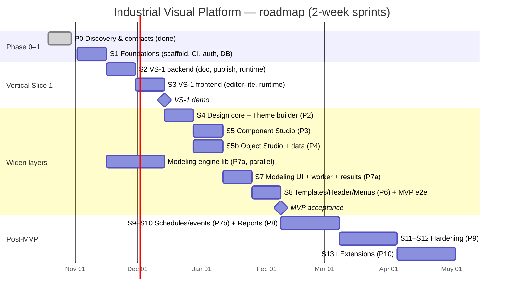
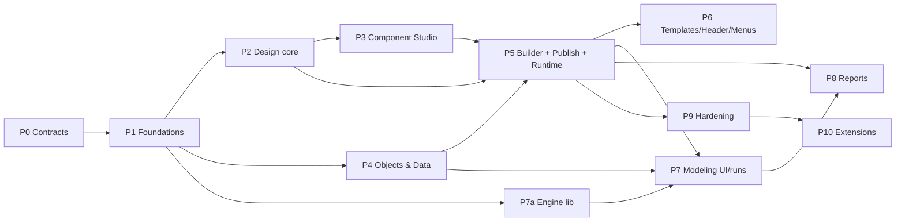

# ۰۵ — نقشهٔ راه (فازهای ۰ تا ۱۰) و اسپرینت‌ها

اسپرینت‌ها دوهفته‌ای؛ شروع فرضی دوشنبه 2026-11-02. راهبرد: **اول یک Vertical Slice نازک از همهٔ لایه‌ها** (VS-1، اسپرینت ۱–۳)، سپس پهن کردن هر لایه. هر فاز = یک حوزهٔ قابلیت؛ اسپرینت‌ها ممکن است چند فاز را موازی جلو ببرند.

## فازها
| فاز | عنوان | خروجی اصلی | پیش‌نیاز |
|---|---|---|---|
| 0 | Discovery & Contracts | همین اسناد، schemas، OpenAPI، ADRها | — |
| 1 | Foundations | scaffold backend/frontend، Docker Compose، CI، DB baseline + MongoDB migrations، iam/session/CSRF، projects، seed roles/units | 0 |
| 2 | Design Core | document-engine (commands, undo/redo, validation)، element registry، rendering، layout engine (flow+grid)، style engine + tokens + responsive، Theme Builder | 1 |
| 3 | Component Studio | definitions/versions، propertySpec → inspector، rendererهای داخلی (KPI, gauge, line/bar chart, table, status, svg-symbol)، usages | 2 |
| 4 | Objects & Data | object types/versions، objects tree، units، data source `scada_http_ws` + credentials، signal browser، DataBindings، live gateway | 1 |
| 5 | Page/Dashboard Builder & Publishing | DnD editor، dashboard grid، preview، publish + pins + bundle، runtime app، revisions/rollback | 2, 3, 4 |
| 6 | Templates, Header/Footer, Menus | template + slot، template parts + display conditions، menus، republish ابزار | 5 |
| 7 | Modeling | engine (parser/AST/DAG/evaluator)، model editor، worker + queue، results، binding `model_output`؛ سپس schedule/event و ورودی تاریخچه‌ای | 1 (engine)، 4 (ورودی‌ها)، 5 (نمایش) |
| 8 | Reports | قرارداد Report، report builder (همان design core)، خروجی PDF/CSV، زمان‌بندی | 5, 7 |
| 9 | Hardening | OIDC، bearer tokens، ارزیابی RLS، CSP/headers، rate limits، backup/restore، observability، load test، audit UI | 5 |
| 10 | Extensions | adapterهای MQTT/OPC UA/SQL، React Flow (گراف اشیاء/مدل)، soft-lock ویرایش، i18n کامل، مقیاس افقی (Redis pub/sub) | 9 |

**MVP** = فازهای ۱ تا ۷ (بخش manual-run) + بخش‌های لازم ۶ (header ساده). هدف: پایان اسپرینت ۸.

## گانت

## گراف وابستگی و کارهای موازی

**موازی‌سازی‌ها:**
- موتور مدل‌سازی (کتابخانهٔ خالص Python) از اسپرینت ۲ به‌طور مستقل توسط مهندس مدل‌سازی جلو می‌رود (ورودی: `contracts/tools/semantic.py`).
- فاز ۳ (frontend-heavy) و فاز ۴ (backend-heavy + یکپارچه‌سازی SCADA) در اسپرینت ۵ موازی‌اند.
- QA: تست‌های قراردادی و e2e هر اسپرینت هم‌زمان با توسعه؛ DevOps: CI/Compose در S1، backup/observability در S11.
- Theme Builder (UI) پس از style engine، موازی با Component Studio ممکن است.

## مسیر بحرانی
P1 → VS-1 (S2–S3) → Design core (S4) → Component Studio (S5) → Modeling UI (S7) → MVP e2e (S8). ریسک اصلی مسیر: دسترسی واقعی به SCADA و قرارداد آن (R-01) — باید در S1 حل شود.
