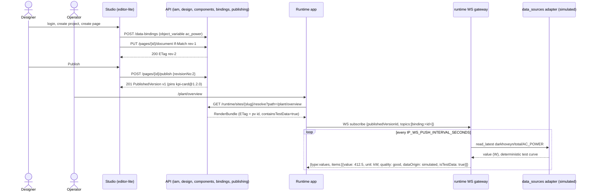

# ۰۸ — Vertical Slice 1: «KPI زندهٔ نیروگاه، از طراحی تا runtime»

## هدف
کوچک‌ترین مسیر end-to-end که **همهٔ لایه‌های معماری** را واقعی (نه mock) طی کند و تصمیم‌های پرریسک را زود اعتبارسنجی کند: document JSONB + revision + optimistic concurrency، component pinning، binding سمت سرور، publish تغییرناپذیر، جدایی runtime از editor، و دادهٔ زنده از طریق adapter منبع داده.

> **اصلاحیه 2026-10-27 (D-05 / ADR-0012):** قرارداد واقعی SCADA قابل تأیید نیست. VS-1 روی data source از نوع **`simulated`** (پشت همان adapter interface) اجرا می‌شود. دادهٔ آن **همه‌جا دادهٔ آزمایشی** برچسب می‌خورد (metadata، پاسخ‌های API با `dataOrigin=simulated`/`isTestData=true`، bundle با `containsTestData`، نشان «داده آزمایشی / Test data» در runtime و studio). adapter `scada_http_ws` مستند ولی پیاده‌نشده و پشت `IP_FEATURE_SCADA_ADAPTER` است. VS-1 هیچ ادعای اتصال به دادهٔ واقعی ندارد. وضعیت اجرا: [09-vs1-status.md](09-vs1-status.md).

**مسیر:** login → ساخت پروژه → ساخت صفحه → افزودن یک KPI و bind به `ac_power` شیء نیروگاه → ذخیره → انتشار → مشاهده در runtime با مقدار زنده.
زمان: اسپرینت ۲ و ۳ (پس از Foundations در S1). کارها: T-201 … T-213.

## در محدوده (In scope)
| لایه | محدوده |
|---|---|
| Auth | login/logout با session cookie + CSRF؛ نقش‌های owner/designer/viewer |
| Project | ساخت و لیست پروژه |
| Object & Data (فقط API/seed، بدون UI) | یک data source `simulated` «Darkhoveyn simulator (TEST DATA)» (`scada_http_ws` فقط مستند و پشت feature flag)، type `solar.site` و `solar.inverter`، شیء `darkhoveyn.site` با `ac_power` ← `darkhoveyn/total/AC_POWER` (W→kW) و `jb-01.inv-01` |
| Component | کامپوننت سراسری seed‌شده `industrial.kpi-card@1.2.0` (renderer `builtin.kpi-card@1`)؛ بدون Component Studio UI |
| Binding | `object_variable` با `delivery.mode=live`، تبدیل واحد |
| Page editor-lite | درخت لایه‌ها، دکمه‌های «افزودن section / row / column / KPI»، inspector تولیدشده از propertySpec (title, decimals, warnBelow, critBelow)، binding picker (شیء + متغیر)، undo/redo، token‌های تم پیش‌فرض |
| Save | `PUT /pages/{id}/document` + If-Match، نمایش conflict 412 |
| Publish | bundle + pins + `bundle_hash`؛ `activate` نسخهٔ قبلی (فقط API) |
| Runtime | اپ `apps/runtime`: resolve مسیر → render → WS `binding:<id>` → نمایش مقدار، واحد، زمان و وضعیت stale/no-data؛ برچسب دادهٔ آزمایشی (بنر صفحه + نشان روی KPI) |
| Audit | ثبت login، save، publish |

## خارج از محدوده (Out of scope)
DnD (در S4)، dashboard grid، Theme Builder UI، Component/Object Studio UI، header/footer/menus/templates، preview session جدا (در VS-1 «preview» = رندر سند جاری با همان renderer در editor)، مدل‌سازی، revisions UI، responsive overrides، media/SVG، OIDC، چند data source.

## معماری درگیر

## کارها
| ID | خلاصه | نقش |
|---|---|---|
| T-201 | documents/pages/revisions + PUT document با If-Match | BE, DB |
| T-202 | validation سند (schema + semantic) | BE |
| T-203 | components + seed KPI + `/renderers` | BE |
| T-204 | object types/objects (API) + seed اسکریپت پایلوت | BE, MOD |
| T-205 | adapter `scada_http_ws` + credentials رمزگذاری‌شده — **مسدود** تا تأیید قرارداد SCADA؛ جایگزین VS-1: T-205a | BE |
| T-205a | adapter `simulated` + برچسب دادهٔ آزمایشی در API/bundle/UI + feature flag برای `scada_http_ws` | BE, FE |
| T-206 | data_bindings + value | BE |
| T-207 | publishing (bundle, pins, activate) | BE, DB |
| T-208 | runtime resolve + WS gateway | BE |
| T-209 | editor-lite (tree, inspector, binding picker, undo/redo) | FE |
| T-210 | shared/rendering + kpi-card renderer + style engine حداقل | FE |
| T-211 | runtime app | FE |
| T-212 | save/publish UI + conflict | FE |
| T-213 | e2e + CI (منبع simulated به‌جای SCADA stub) | QA, OPS |

## تست‌های پذیرش
| AT | سناریو | انتظار |
|---|---|---|
| AT-1 | login با کاربر seed، ساخت پروژه `darkhoveyn-pilot` | 201؛ کوکی `HttpOnly; SameSite=Lax`؛ پروژه در لیست |
| AT-2 | ساخت صفحه `/plant/overview`، افزودن section › row › column › KPI از UI، تنظیم عنوان «توان AC کل» و decimals=1، bind به `darkhoveyn.site.ac_power` | بدون نوشتن کد؛ سند ذخیره‌شده با `page.schema.json` معتبر است |
| AT-3 | دو تب هم‌زمان سند را ذخیره می‌کنند | تب دوم 412 با `currentEtag` و پیام قابل فهم؛ هیچ داده‌ای بی‌صدا رونویسی نمی‌شود |
| AT-4 | ذخیرهٔ سند دست‌کاری‌شده (column زیر section، style `url(javascript:…)`، version `^1.0.0`) از طریق API | 422 با `errors[].pointer` درست؛ revision جدید ساخته نمی‌شود |
| AT-5 | Publish | 201؛ `pins.components = [{kpi-card, 1.2.0}]`؛ `bundle_hash` ثبت |
| AT-6 | کاربر viewer مسیر runtime را باز می‌کند | KPI با مقداری **برابر با منبع simulated** (`round(sample(darkhoveyn/total/AC_POWER, sourceTimestamp)/1000, 1)`)، واحد kW، زمان آخرین مقدار و `dataOrigin=simulated`, `isTestData=true` — هم در REST values و هم در پیام WS. (نسخهٔ قبلی این AT با SCADA واقعی تا تأیید قرارداد مسدود است.) |
| AT-7 | منبع قطع می‌شود (`offline=true` در config منبع simulated) | KPI `quality=no_data` و `value=null`؛ هیچ عددی نمایش داده نمی‌شود؛ پس از وصل مجدد (`offline=false`) بدون اقدام کاربر ادامه |
| AT-8 | ویرایش و publish دوم (عنوان جدید)؛ سپس `activate` نسخهٔ ۱ | runtime عنوان قدیم را نشان می‌دهد؛ `bundle_hash` نسخهٔ ۱ بدون تغییر؛ UPDATE مستقیم روی `published_versions` در DB خطا می‌دهد |
| AT-9 | کاربر عضو پروژهٔ دیگر به `GET /pages/{id}` این پروژه | 404 |
| AT-10 | WS subscribe به `binding:<id>` که در bundle نیست | `{"type":"error","code":"forbidden_topic"}` |
| AT-11 | بررسی bundle runtime | فاقد dnd-kit/inspector (گزارش visualizer)؛ هیچ secret یا baseUrl SCADA در پاسخ‌های API و bundle نیست (grep در CI) |
| AT-12 | audit | رکوردهای `auth.login`, `page.document.saved`, `page.published`, `page.activated` با actor و request id |
| AT-13 | برچسب دادهٔ آزمایشی | data source: `isTestData=true`؛ هر BindingValue و پیام WS: `isTestData=true`؛ bundle و PublishedVersion: `containsTestData=true` و `bindingOrigins`؛ runtime و studio نشان/بنر «داده آزمایشی / Test data» را **همیشه** نشان می‌دهند (حتی پیش از اولین مقدار)؛ ساخت `scada_http_ws` بدون feature flag → 422 `adapter_not_available` |

## تعریف «انجام‌شده» (DoD) برای VS-1
- همهٔ AT-1…AT-13 خودکار سبز (pytest integration روی MongoDB واقعی (از 2026-11-01؛ قبلاً PostgreSQL) + vitest + بررسی bundle). AT-6/AT-7 روی SCADA واقعی تا تأیید قرارداد **خارج از DoD این اسلایس** و در T-205 پیگیری می‌شود.
- migrationها up/down سبز؛ OpenAPI drift صفر؛ پوشش تست ماژول‌های design/publishing ≥ ۸۰٪.
- ADRهای مرتبط به Accepted تغییر کرده یا اصلاح شده‌اند بر اساس یافته‌ها.
